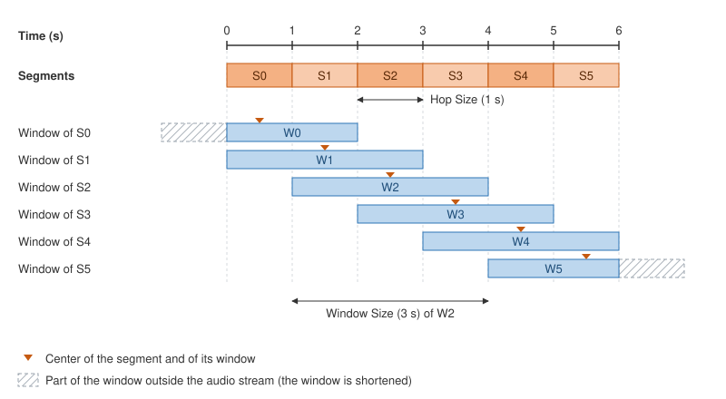

<h1 align="center">Clap Vamp Plugin Manual</h1>

<p align="center">
<i>Version APPVERSION for Windows, Mac & Linux</i><br>
<i>Manual by Pierre Guillot</i><br>
<a href="www.ircam.fr">www.ircam.fr</a><br><br>
</p>

<p align="center">

</p>

## Table of contents

1. [Introduction](#introduction)
2. [Requirements](#requirements)
3. [Installation](#installation)
4. [Analysis windows](#analysis-windows)
5. [CLAP Prompt: tagging with text prompts](#clap-prompt-tagging-with-text-prompts)
6. [CLAP Example: tagging and search by example](#clap-example-tagging-and-search-by-example)
7. [CLAP Novelty: change detection](#clap-novelty-change-detection)
8. [Models](#models)
9. [Use cases and limitations](#use-cases-and-limitations)
10. [Credits](#credits)

## Introduction

The Clap plugins are implementations of the [CLAP](https://github.com/LAION-AI/CLAP) and [CLAP2](https://projects.laion.ai/clap2/) contrastive language-audio models developed by [LAION](https://laion.ai/) as [Vamp plugins](https://www.vamp-plugins.org/).

Contrary to conventional classification models, CLAP jointly learns the audio and text representations in a shared embedding space: the audio and the texts are converted into vectors of the same dimension (the embeddings), whose proximity indicates their semantic correspondence. The plugin library contains three plugins that use these embeddings in different ways:

- **CLAP Prompt** compares the audio with text prompts. This makes zero-shot audio tagging possible: the sounds of an audio stream can be described by any text prompt, without training. The prompts can be organized hierarchically (for example, *Animal/Bird/Owl*).
- **CLAP Example** compares the audio with annotated regions of the same audio stream. It tags the audio with the classes of the examples (for example, the emotions of a speaker or the species of an animal annotated in a few places) and finds the parts of the audio stream that sound like the examples.
- **CLAP Novelty** compares the audio with itself, without prompt nor example, to detect the changes of content (for example, the sections of a piece of music or the changes of sound scene).

The plugin bundle embeds CLAP2 and CLAP models and the *Model* parameter is used to select which one to use. You can also use other models that may be more appropriate to your needs. Please, refer to the section dedicated to models.

The Clap Vamp Plugin has been designed for use in the free audio analysis application [Partiels](https://forum.ircam.fr/projects/detail/partiels/).

## Requirements

- Windows 10
- MacOS 13.3 (ARM)
- Linux

## Installation

Use the installer for your operating system (on Linux, run the *Install.sh* script of the archive). The plugin bundle *ircamclap.vamp*, which contains the dynamic library, the category file and the models, will be installed in your operating system's Vamp plugin installation directory:
- Linux: `~/vamp`
- MacOS: `/Library/Audio/Plug-Ins/Vamp`
- Windows: `C:\Program Files\Vamp Plugins`

## Analysis windows

The three plugins analyze the audio stream in the same way. The audio is divided into consecutive segments of *Hop Size* duration and each segment is analyzed with a window of *Window Size* duration centered on the segment. The features of a window are positioned on its segment, so that the features follow each other without overlap. At the beginning and at the end of the audio stream, the windows are shortened. For example, with a hop size of 1 second and a window size of 3 seconds:

<p align="center">

</p>

The segment *k* covers the interval [*k* × *Hop Size*, (*k* + 1) × *Hop Size*[ and its features are positioned on it (the last segment is shorter if the duration of the audio stream is not a multiple of the hop size). Its window covers the interval [(*k* + ½) × *Hop Size* − *Window Size* / 2, (*k* + ½) × *Hop Size* + *Window Size* / 2[.

- **Model**: the model used to generate the embeddings.
- **Window Size**: the duration of the analysis windows, in seconds, between 1 and 10. The CLAP2 models analyze the window as is, the CLAP models repeat a window shorter than 10 seconds to fill their 10-second input. A longer window requires more computation time.
- **Hop Size**: the duration between two analysis windows, in seconds, between 0.1 and 10. A shorter hop size gives a better time resolution but requires more computation time: the computation time is proportional to the number of windows (the duration of the audio divided by the hop size), and the cost of a window varies little with its size. A hop size between a quarter and half of the window size is a good compromise. A hop size shorter than 0.1 to 0.2 second brings no additional precision because the models analyze the audio in frames of this order of duration.

A long window describes the global content of the audio, a short window describes the local events. When the window is shorter than the sounds to detect, the description is more precise.

## CLAP Prompt: tagging with text prompts

### Inputs

The text prompts are mandatory and must be provided as the precomputed markers of the plugin input, one marker per prompt, from the tools or the annotations of the host. For example, in Partiels, you can create an annotation track with one marker per prompt, such as *A man speaks.*, *A woman sings.*, *A guitar plays a melody.* or *People are applauding.*. Without prompt, the plugin generates no result. The empty and duplicate prompts are ignored.

The models are trained with English captions, hence the prompts must be written in English (the audio can contain speech in any language). The models are trained with full sentences in the style of audio captions: prefer *A dog barks.* to *dog* and avoid negations (such as *no background music*). The tokenizer of the CLAP2 models is case-sensitive: write the prompts in normal sentence case.

### Hierarchical prompts

The prompts can be organized hierarchically by separating their levels with slashes, for example:

```
Animal/A dog barks.
Animal/A bird sings./An owl hoots.
Animal/A bird sings./A crow caws.
Music/A piano plays.
Music/A choir sings.
Speech
```

Each level of a prompt defines a node of the hierarchy (here *Animal*, *Animal/A dog barks.*, *Animal/A bird sings.*, *Animal/A bird sings./An owl hoots.*, etc.). A level is represented by the average embedding of its own text and of the texts of all its sublevels: the level *Animal* combines *Animal*, *A dog barks.*, *A bird sings.*, *An owl hoots.* and *A crow caws.*, which is more robust than the word *Animal* alone. A prompt without slash is a top-level node without sublevel, hence a list of prompts without slash is a flat list of prompts.

The tag is the most similar node among all the levels. Because a level averages the descriptions of its sublevels, it is selected when none of its sublevels matches the audio better: for example, a sound of bird that does not match any specific species is tagged *Animal/A bird sings.* rather than an uncertain species. The levels whose sublevels are unreliable (such as the age of a voice) are thus naturally avoided.

> ⚠️ A slash in a prompt always separates two levels: do not use slashes in the texts of the prompts.

### Outputs

The **Class Scores** output generates, for each analysis window, the similarity scores between the audio and all the nodes of the prompts (a parent level precedes its sublevels, the siblings keep the order of the input prompts). The scores range from -1 to 1, a higher score meaning that the prompt better matches the audio. In practice, the scores of the matching prompts are often between 0.15 and 0.4, hence the output declares a display range from 0 to 0.5 (the values are not modified: a score outside this range is possible, and the range can be changed in the host).

The **Class Probabilities** output generates, for each analysis window, the probabilities of all the nodes of the prompts, between 0 and 1. The probabilities are computed with the softmax of the similarity scores among the siblings (the prompts of the same level), scaled by the temperature learned by the model (approximately 125 for the CLAP2 models and 27 to 39 for the CLAP models, 100 for the models without trained temperature). The probability of a sublevel is the probability of its parent multiplied by its probability among its siblings, hence the probabilities of the top-level prompts sum to 1 and the probabilities of the sublevels of a prompt sum to the probability of this prompt. The probabilities are easier to read than the similarity scores, but they are relative to the set of prompts: adding or removing a prompt changes the probabilities of its siblings, and a prompt can have a high probability if no prompt really matches the audio (look at the similarity scores in this case).

The **Best Class** output generates a marker for each analysis window with the full path of the most similar node as label, and its similarity score and its probability as values (the best class is selected according to the similarity scores, because the probability of a parent is always higher than the probabilities of its sublevels). A marker is generated for each window: filter the markers according to their similarity score or their probability in the host (in Partiels, with the threshold of the extra outputs of the track), for example to ignore the windows whose best score is below 0.15.

### Parameters

- **Model**, **Window Size** (10 seconds by default) and **Hop Size**: see the [analysis windows](#analysis-windows).

## CLAP Example: tagging and search by example

### Inputs

The examples are mandatory and must be provided as the precomputed markers of the plugin input, for example with an annotation track of the same audio file in Partiels. Each marker defines an audio region (from the time of the marker over its duration) and its label defines the class of the example, for example *Angry*, *Calm*, *Blackbird* or *Chorus*. A marker without duration defines a region of the window size centered on the marker and a marker without label is an example of the class *Example*. Several regions can have the same class: their embeddings are averaged. Without example, the plugin generates no result.

The classes can be organized hierarchically by separating their levels with slashes (such as *Bird/Blackbird* and *Bird/Robin*): the examples of a class are also used for its parent classes (the class *Bird* averages the examples of *Bird/Blackbird* and *Bird/Robin*), and the tag is the most similar class among all the levels, as with the hierarchical prompts of the CLAP Prompt plugin.

A few examples per class (from 3 to 10 regions, as diverse as possible) are generally sufficient. The regions should only contain the sound of their class and their duration should be close to the window size. The regions longer than the window size are analyzed by consecutive parts of the window size whose embeddings are averaged.

### Outputs

The **Class Scores** output generates, for each analysis window, the similarity scores between the audio and the examples of each class. The similarity scores between sounds are generally high (often above 0.8 for sounds of the same recording), hence the relative variations of the scores are more significant than their absolute values and the output declares a display range from 0.5 to 1 (the values are not modified and the range can be changed in the host). With a single class, this output finds the parts of the audio stream that sound like the examples (query by example).

The **Best Class** output generates a marker for each analysis window with the most similar class as label and its similarity score as value. Filter the markers according to their similarity score in the host if necessary (for example, to ignore the windows whose best score is below 0.8).

The windows that contain the examples obviously match their class: to evaluate the tagging, look at the windows outside the examples. The features are generated at the end of the analysis, because the examples can be anywhere in the audio stream.

### Parameters

- **Model**, **Window Size** (5 seconds by default) and **Hop Size**: see the [analysis windows](#analysis-windows).

## CLAP Novelty: change detection

### Outputs

At each boundary between two analysis windows, the plugin compares the average embedding of the windows entirely before the boundary with the average embedding of the windows entirely after the boundary, over the duration of the *Context* parameter. The windows that overlap the boundary and the shortened windows at the beginning and at the end of the audio stream are ignored: a boundary requires at least one complete window entirely before it and one entirely after it. During approximately the window size at the beginning and at the end of the audio stream (5 seconds by default), no change is considered: the novelty is zero and no boundary is detected. Near the beginning and the end, the comparison uses the available windows, even if they cover less than the context duration.

The **Novelty** output generates the novelty at each boundary: the cosine distance between the embeddings before and after the boundary. The novelty is theoretically between 0 (the content does not change) and 2 (opposite embeddings), but the audio embeddings of a model always remain quite similar (their cosine similarity is generally above 0.7), hence the novelty is never negative and rarely exceeds 0.5.

The **Boundary** output generates a marker at each peak of the novelty, with the novelty as value. Two boundaries are separated by at least the context duration. All the peaks are generated, including the small variations of the content: filter the boundaries according to their novelty value in the host (in Partiels, with the threshold of the extra output of the track).

The scale of the novelty depends on the model: for example, the novelty of the changes of sections of a song is around 0.08 to 0.15 with the CLAP2 Small model and around 0.1 to 0.3 with the CLAP General model, while a recording without change stays below 0.03 with the CLAP2 Small model. The output declares a display range from 0 to 0.3 (the values are not modified and the range can be changed in the host). Look at the Novelty output to choose the filtering threshold. The features are generated at the end of the analysis.

### Parameters

- **Model**, **Window Size** (5 seconds by default) and **Hop Size**: see the [analysis windows](#analysis-windows).
- **Context**: the duration compared before and after each boundary, and the minimum duration between two boundaries, in seconds, between 0.1 and 60 (5 seconds by default). A longer context detects the changes of larger sections and ignores the short events. A context equal to the hop size compares the adjacent windows, which gives the most precise localization of the changes but is more sensitive to the short events.

## Models

By default, the plugins use the *CLAP2 Small* model, which offers a good balance between quality, space and computation time. The models are numbered in the *Model* parameter, and their name indicates the precision of their weights in parentheses (F16 for 16-bit floating-point numbers, Q8_0 and Q4_K_M for the weights quantized on 8 and about 4 bits). The following models are embedded in the Resources folder of the plugin bundle:

| # | Model | File | Embedding dimension | Description |
| --- | --- | --- | --- | --- |
| 1 | CLAP2 Small (F16) | clap2-small-audioxl-s1B-f16 | 512 | General model (speech, music and sounds), 104 M parameters (default model) |
| 2 | CLAP2 XXS (F16) | clap2-xxs-audioxl-s1B-f16 | 224 | Fast and light general model, 27 M parameters |
| 3 | CLAP General (Q8_0) | larger_clap_general-q8_0 | 512 | Trained on a wide variety of sounds |
| 4 | CLAP General (Q4_K_M) | larger_clap_general-q4_k_m | 512 | Quantized variant of the model 3 |
| 5 | CLAP Music and Speech (Q8_0) | larger_clap_music_and_speech-q8_0 | 512 | Trained on music and speech |
| 6 | CLAP Music and Speech (Q4_K_M) | larger_clap_music_and_speech-q4_k_m | 512 | Quantized variant of the model 5 |

The CLAP2 models are trained on 366 million audio-text pairs (45% speech, 22% music) and generally outperform the CLAP models. The Q4_K_M variants of the CLAP models require less space and offer faster computation but less robust results.

The larger_clap_music model is not embedded and its use is not recommended, even for music: the published checkpoint of this model ([laion/larger_clap_music](https://huggingface.co/laion/larger_clap_music/discussions/2)) generates almost identical embeddings for all the texts, hence all the prompts have the same score, and its audio embeddings vary very little. For music, prefer the CLAP2 Small and CLAP Music and Speech models.

It is possible to use other models that are potentially more robust or more adapted to your needs. For example, the [clap2-large](https://huggingface.co/gorse-io/clap2-large-audioxl-s1B-GGUF) (340 M parameters, 682 MB), [clap2-medium](https://huggingface.co/gorse-io/clap2-medium-audioxl-s1B-GGUF) and [clap2-xs](https://huggingface.co/gorse-io/clap2-xs-audioxl-s1B-GGUF) models, and more generally the gguf models of the [Audio Embedding GGUF](https://huggingface.co/collections/gorse-io/audio-embedding-gguf) collection of the [Clap.cpp](https://github.com/gorse-io/clap.cpp) project (the models without text support, such as MERT and MuQ, can only be used with the CLAP Example and CLAP Novelty plugins). The models must be placed in a directory and the `CLAPMODELSPATH` environment variable must be set to the path of this directory. On MacOS, the applications launched from the Finder or the Dock do not inherit the environment variables defined in the shell configuration files (such as *.zshrc*): use `launchctl setenv CLAPMODELSPATH /path/to/models` and restart the application.

Once the environment variable is set, you can select the models in the plugin properties window. The embedded models are always listed first, followed by the models of the directory in alphabetical order of their file names, numbered from 7. The names of the CLAP and CLAP2 models are displayed in the same way as the embedded models (for example, *7. CLAP2 Large (F16)* for the clap2-large-audioxl-s1B-f16.gguf file), the other models are displayed with their file name.

> ⚠️ Please note that if you delete, rename or add models in this directory, the models of the directory will no longer be indexed in the same way, and the plugin may no longer be able to find the selected model. After modification, make sure that the model name corresponds to the one you want.

The weights of a model are loaded once and shared by all the analyses that use it.

[Further information](https://github.com/gorse-io/clap.cpp) on downloading and generating models can be found on the Clap.cpp project page.

## Use cases and limitations

The text prompts work well when the sound can be described by a usual English caption: categories of sounds (speech, singing, instruments, animals, vehicles, weather, etc.), musical genres and instrumentation, spoken words. They work poorly for fine categories that are rarely named in captions, such as the emotions of a voice or the species of an animal: in these cases, prefer the CLAP Example plugin with a few annotated regions. The models do not capture precise numerical attributes (pitch, tempo, key), counting or temporal order (*two knocks then a scream*), and the time resolution is limited by the analysis windows.

## Credits

- **[Clap Vamp plugin](https://www.ircam.fr/)** by Pierre Guillot at IRCAM
- **[Clap.cpp](https://github.com/gorse-io/clap.cpp)** by Gorse
- **[CLAP](https://github.com/LAION-AI/CLAP)** and **[CLAP2](https://github.com/LAION-AI/clap2)** models by LAION ([LAION-Audio-XL: A Web-Scale Corpus and Scaling Studies for Contrastive Language-Audio Pretraining](https://arxiv.org/abs/2611.11592), Wijngaard et al., 2026)
- **[Vamp](www.vamp-plugins.org)** by the Centre for Digital Music, Queen Mary, University of London

The Clap Vamp Plugin is distributed under the MIT License. Clap.cpp and the embedded CLAP and CLAP2 models are distributed under the Apache License 2.0, and the other third-party libraries under permissive licenses (MIT, Unicode License V3, BSD 3-Clause). The third-party notices and the full texts of the licenses are in the Resources/licenses folder of the plugin bundle.
